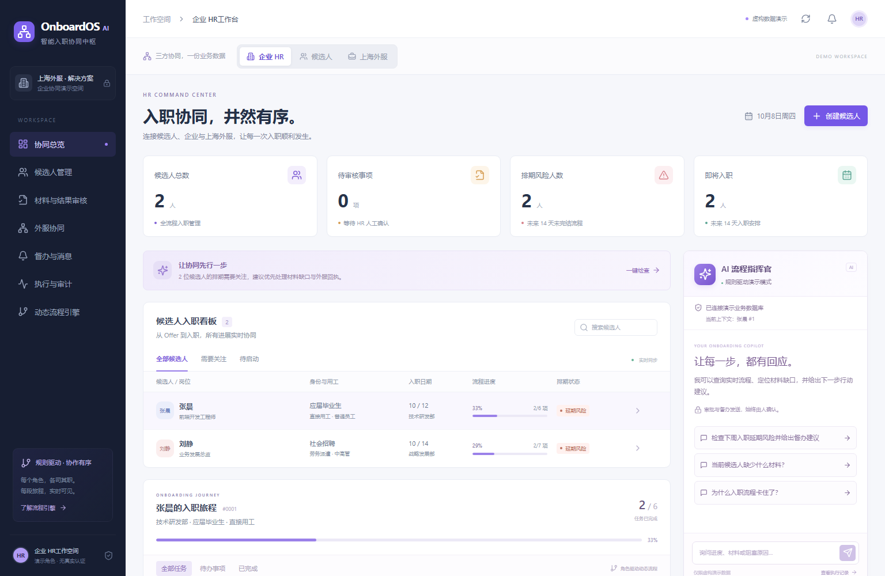
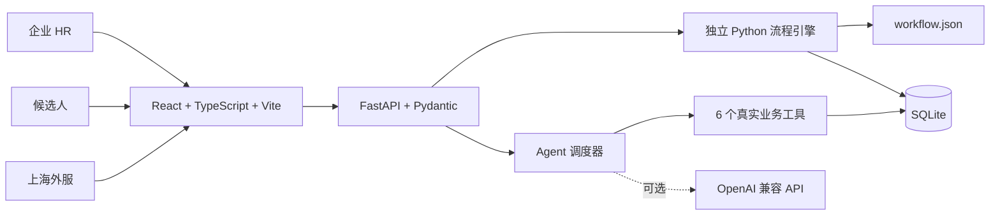

# OnboardOS AI · 智能入职协同中枢

围绕候选人「收到 Offer → 材料提交 → 人工审核 → 外服协同 → 正式入职」的可运行企业 AI Agent Web Demo。以上海外服智能入职方案为业务背景，连接企业 HR、候选人和上海外服服务人员。

**所有姓名、材料、服务结果和政策均为虚构模拟数据。本项目与真实上海外服业务系统没有连接，不代表其正式产品或政策。**

## 核心功能演示



上图来自本地实际运行的 Demo，展示企业 HR 协同总览与 Agent 助手面板；当前为规则驱动演示模式。

- **动态流程编排**：按候选人身份、岗位类别和用工模式生成不同任务，自动建立前置依赖；必需任务未完成时，下游流程保持阻塞。
- **多角色协同**：企业 HR、候选人和上海外服共用同一份业务数据，材料提交、审核和外服结果回传实时同步；审批环节保留人工确认。
- **Agent 智能督办**：通过真实后端工具查询入职进度、缺失材料、阻塞任务和外服状态，识别排期风险并生成督办建议；HR 确认后才创建督办任务与站内提醒，实际工具调用可追溯。

无需模型 API 即可体验完整业务闭环；配置兼容 API 后可切换为由 LLM 选择工具的模式。截图不代表真实模型调用或真实外部服务执行。

## 已实现

- 企业 HR：指标看板、候选人创建、发送模拟 Offer、动态任务时间线、逐项材料审核、外服结果人工确认、最终入职确认。
- 候选人：入职准备度、真实任务状态、提交占位演示材料、退回后重新提交、站内提醒、AI 入职陪伴官。
- 上海外服：任务接收、服务进度更新、模拟结果回传。回传进入待审核，HR 确认后才完成。
- 独立 Python 流程引擎：JSON 条件规则、动态前置依赖、后端状态机、防止跳过前置任务。
- Agent：6 个真实业务工具、日期范围风险检查、督办建议、人工确认后生成督办任务与站内消息、SQLite 工具执行日志。
- 两种运行方式：无需 API 的规则驱动演示；配置 OpenAI 兼容 Chat Completions API 后由模型选择工具。
- 三个工作台共用同一 SQLite 数据库；每 5 秒拉取最新状态，当前页面操作成功后立即刷新。

## 技术架构



前端使用 Tailwind CSS v4、Lucide React 和原生 CSS 组合构建企业 SaaS 界面。依赖通过 `frontend/package-lock.json` 和 `backend/requirements.lock.txt` 记录。

```text
onboardos-ai/
  backend/
    app/
      main.py           # REST API、输入验证与演示角色操作检查
      db.py             # SQLite schema、连接与审计
      engine.py         # 规则生成、依赖门控、状态机
      workflow.json     # 条件模板与明确标注的模拟政策
      service.py        # 候选人聚合、排期风险、演示种子
      agent_tools.py    # 6 个数据库工具、参数校验与日志
      agent.py          # 规则模式 / LLM 工具调用循环 / 透明降级
    tests/              # 使用临时 SQLite 的后端业务测试
    data/               # 首次启动自动创建 SQLite（不纳入版本管理）
  frontend/
    src/                # 三方工作台、任务、Agent、人工确认弹窗
    tests/              # 独立测试服务与数据库的 Playwright 测试
  scripts/start.ps1     # 本机隐藏启动两个服务，检查端口和就绪状态
  scripts/stop.ps1      # 校验进程身份后停止此项目，保留数据
  docs/                # 实际测试结果、浏览器截图
  .env.example
```

## 本机启动（Windows PowerShell）

已安装本地依赖时，在项目根目录执行：

```powershell
.\scripts\start.ps1
```

- Web：http://127.0.0.1:5173
- API 文档：http://127.0.0.1:8000/docs
- 健康检查：http://127.0.0.1:8000/api/health
- 日志：`logs/api.err.log`、`logs/web.err.log`

脚本仅绑定本机回环地址，不会停止其他项目的进程。端口已占用时会明确报错。停止：

```powershell
.\scripts\stop.ps1
```

如果 PowerShell 执行策略阻止本地脚本，可仅对该次进程使用：

```powershell
powershell -ExecutionPolicy Bypass -File .\scripts\start.ps1
```

首次安装：建议 Node.js 22.12+ 与 Python 3.11+，本机实测 Node 26.7 / Python 3.12。

```powershell
python -m venv .venv
.\.venv\Scripts\python.exe -m pip install -r backend\requirements.lock.txt
cd frontend
npm ci
cd ..
Copy-Item .env.example .env
.\scripts\start.ps1
```

也可以开两个终端手动启动：

```powershell
# 终端 1，项目根目录
.\.venv\Scripts\python.exe -m uvicorn app.main:app --app-dir backend --host 127.0.0.1 --port 8000

# 终端 2，frontend 目录
npm run dev
```

Vite 将 `/api` 代理到 `127.0.0.1:8000`。`npm run build` 生成生产静态文件；`npm run preview` 仅用于静态构建预览，实际 API 演示请使用开发服务，或部署时配置同源反向代理。

## 业务规则与状态

规则唯一配置来源为 `backend/app/workflow.json`，条件匹配和依赖门控在 `engine.py`。前端直接渲染后端返回的 `actions` 与 `blocked_by`，不自行判断业务条件。

| 条件 | 增加的任务 |
| --- | --- |
| 应届毕业生 | 三方协议 |
| 中高管 | 上海外服模拟背景调查 |
| 劳务派遣 | 派遣用工协议 |
| 所有人 | Offer 确认、基础材料、材料汇总审核、模拟体检服务协调、最终入职确认 |

状态为：`pending` 待处理、`in_progress` 进行中、`pending_review` 待审核、`completed` 已完成、`blocked` 已阻塞。

- 确认 Offer 后，材料任务和对应服务任务解锁。
- 材料提交后变为待审核；HR 可通过或注明原因退回。
- 各项必需材料审核完成后，解锁「材料汇总审核」。
- 外服需先接收，再更新进度或回传结果。回传结果保持待审核。
- 材料汇总审核和全部必需服务都人工确认完成后，才解锁最终入职确认。
- 不提供任意更改任务状态的接口；前端隐藏操作之外，后端也会重新检查依赖、角色、状态和确认参数。
- 排期启发式：未完成且距入职不超过 7 天标为高风险；不超过 14 天标为需要关注。逾期未完结也纳入。只供排期提示，不用于录用或法律判断。
- 所有日期按 Asia/Shanghai 计算；「下周」严格指下周一至周日。

## Agent 与人工控制

独立工具可在 `backend/app/agent_tools.py` 查看：

| 工具 | 实际数据行为 |
| --- | --- |
| `get_candidate_status()` | 查询候选人、当前任务、进度与日期风险 |
| `get_missing_documents()` | 区分未交材料和已交待审核材料 |
| `find_blocked_tasks()` | 查询被阻塞任务及真实前置依赖 |
| `get_external_service_status()` | 查询外服任务和模拟回传结果 |
| `create_followup_task()` | 模型/规则调用仅保存待确认建议；HR 确认后才写督办任务与站内提醒 |
| `get_onboarding_policy()` | 读取 JSON 中明确标注的演示政策 |

规则模式使用确定性意图分流，但状态、缺失材料、阻塞原因和服务结果都来自即时数据库查询。界面明确显示「规则驱动演示模式」，不会声称执行了真实模型调用。展开每次回复下的执行记录，可查看参数、数据库返回、模式、耗时、运行 ID 和成功状态；完整记录在「执行与审计」。

模型模式在 `.env` 设置：

```dotenv
LLM_ENABLED=true
LLM_API_KEY=填入你自己的兼容服务密钥
LLM_BASE_URL=https://你的兼容服务/v1
LLM_MODEL=你的服务支持工具调用的模型名
LLM_TIMEOUT=30
```

修改后重启后端。这里采用 `/chat/completions` 的 function tools 协议，兼容服务及所选模型必须支持该协议。首次模型调用要求执行工具，然后将真实工具结果回传给模型继续生成；最多 5 轮、每轮最多 8 次工具调用。API 不可用或返回格式异常时明确告知本次降级到规则模式，工具日志继续记录实际来源。没有真实密钥时不测试真实模型服务，也不会自动借用其他产品凭据。

工具白名单不暴露审批、任意 SQL、通知发送或状态更新。模型不能传入 `confirmed=true`。所有实际审批、最终入职、督办发送通过人工确认弹窗和专用 API 执行。候选人工具查询限制在当前演示候选人 ID。

## 现场演示脚本（约 6–8 分钟）

1. **总览（30 秒）**：打开 HR 工作台。介绍指标、左侧导航、右侧 Agent 和顶部三角色切换。
2. **比较案例（30 秒）**：点击张晨，查看应届生三方协议缺失；点击刘静，展示中高管背景调查和派遣协议。两个流程真实不同。
3. **动态创建（1 分钟）**：创建虚构候选人，选应届生 / 中高管 / 劳务派遣。保存，再点击「发送 Offer / 启动入职流程」，展示 8 个动态生成任务和下游阻塞。
4. **Agent 查询（1 分钟）**：选张晨，切换候选人，点击「我还有什么材料没交？」和「为什么我的入职流程卡住了？」。展开工具记录，展示 SQL 业务数据返回的三方协议与依赖。
5. **材料闭环（1 分钟）**：提交三方协议模拟材料；切 HR，审核通过，再确认材料完整。观察任务解锁和进度变化。
6. **外服协同（1 分钟）**：切外服，找到刘静的背景调查，更新进度、提交模拟结果。切 HR 查看「待审核」，通过后再看流程同步。也可完成张晨的体检服务协调并由 HR 确认。
7. **风险督办（1 分钟）**：HR Agent 点击「检查下周入职延期风险并给出督办建议」。进入「督办与消息」，查看建议，人工确认发送。切候选人查看真实写入的站内提醒。
8. **最终入职（30 秒）**：当某人全部材料与服务完成人工审核后，点击最终入职确认，进度变为 100%。

首次数据库为空时自动生成两名候选人，入职日为创建数据库时的下周一（张晨）和下周三（刘静）。预置材料已审核的部分会注明「预置演示」。同一数据库重启不重复播种、不重置状态。若演示日期跨周，可创建新的候选人并选下周日期。

需要重做演示时，先停止项目，将 `backend/data/onboardos.sqlite3` 及对应 `-wal`、`-shm` 文件备份到自己的位置，再重新启动；空数据库会重新播种。没有自动清空数据的按钮，避免现场误操作。

## 验证方法

```powershell
# 项目根目录：独立临时数据库，不影响演示数据
.\.venv\Scripts\python.exe -m pytest backend\tests -q

# 前后端已经启动时：通过实际前端代理核对数据库与 Agent 返回
.\.venv\Scripts\python.exe scripts\smoke.py

cd frontend
npm run build
npx playwright install chromium
npm run test:e2e
```

Playwright 自动使用 8001/5174 端口和 `.test-data` 下独立数据库，不污染 8000/5173 的现场演示数据。测试覆盖三角色创建、Offer、材料、Agent 查询、审核、外服回传、最终入职、督办消息和移动端布局。浏览器截图写入 `docs/`；报告位于 `frontend/playwright-report/`。实际运行结果见 [docs/TEST_RESULTS.md](docs/TEST_RESULTS.md)。

## 商业化构想

- **角色驱动动态流程引擎**：把客户各自的身份、岗位和用工模板配置成版本化规则，减少人工 Excel 比对。
- **上海外服协同工作台**：将服务分派、SLA、回执和企业确认串联，为跨组织服务提供可见性。
- **AI 准员工陪伴官**：按真实进度回答材料、阻塞和报到问题，降低重复咨询和补交成本。
- **HR 流程指挥官**：识别临近入职的流程缺口，生成可审查的督办建议，保留人工审批与审计。

可探索按企业订阅、活跃入职人数和服务模块收费。正式商业验证需测量材料一次通过率、平均入职准备周期、HR 人均处理量和候选人咨询次数；本 Demo 没有虚构节省比例或客户成果。

## 当前限制与生产要求

- **这是演示角色切换器，不是真实登录或安全权限边界。** API 角色由客户端传入；虽然有操作检查与候选人工具范围检查，但生产必须实现真实身份认证、服务端 RBAC、组织隔离与最小权限。
- 演示候选人列表、工具日志、审计记录可在工作空间访问，生产必须按租户和角色过滤。生产需落实个人信息保护、告知与同意、脱敏、加密、保留期限、删除权、备份与访问审计。
- 不接入真实背调、身份核验、健康信息、短信、邮件或第三方企业系统。材料是占位提交，无文件上传、OCR 或自动真实性判断。
- AI 输出只是流程建议，不具法律效力，不是审核结论；录用与最终入职均由 HR 人工决定。
- SQLite 和轮询适合单机 Demo；生产需完善数据库迁移、并发控制、异步队列、SLA、幂等键、告警和监控。
- Agent 每轮按当前上下文查询，不提供长会话记忆；切换角色/候选人会清空面板会话，实际执行日志仍保存在数据库。
- 模型模式已做模拟兼容服务的协议测试；**没有真实 API 密钥时，无法验证具体供应商和模型的可用性**。只支持兼容 Chat Completions 工具协议的模型。
- 无真实生产部署、身份认证、企业品牌授权或正式劳动政策适配；下一步应在受控数据和真实权限基础上进行业务评估。

实现参考：[Vite 官方文档](https://vite.dev/guide/)、[Tailwind Vite 集成](https://tailwindcss.com/docs/installation/using-vite)、[FastAPI CORS](https://fastapi.tiangolo.com/tutorial/cors/)、[OpenAI 官方工具调用文档](https://developers.openai.com/api/docs/guides/function-calling)。
